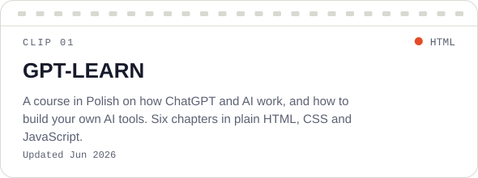
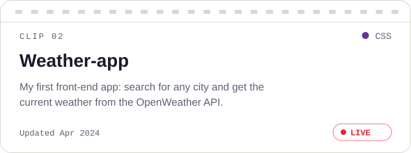
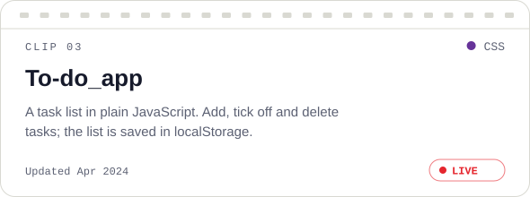
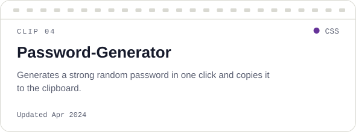
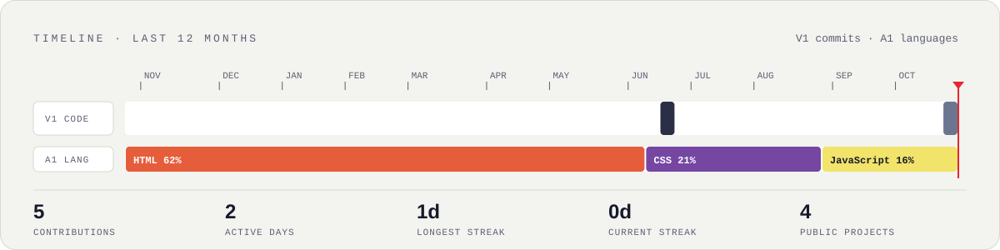

<picture>
  <source media="(prefers-color-scheme: dark)" srcset="assets/header-dark.svg">
  
</picture>

  
  
  
  
  

## Hi, I'm Oskar

I build websites, shoot and edit short-form video, and take photographs. I hold the Polish **INF.02** and **INF.03** IT qualifications, and my day job is in international freight forwarding.

- 🎬 **Now:** an interactive CV site with Three.js, GSAP and an Express admin panel
- 🌱 **Learning:** modern JavaScript, animation on the web, 3D in the browser
- 🤝 **Open to:** junior front-end roles and video commissions

<table>
  <tr>
    <td width="50%" valign="top">
      <h3>&lt;/&gt; Code</h3>
      <picture>
        <source media="(prefers-color-scheme: dark)" srcset="https://skillicons.dev/icons?i=html%2Ccss%2Cjs%2Creact%2Ctailwind%2Cmysql%2Cgit%2Cvscode%2Clinux%2Cwindows%2Cfigma%2Cnotion&perline=6&theme=dark">
        
      </picture>
      
Hand-written HTML, CSS and JavaScript, on top of systems and networking fundamentals.

    </td>
    <td width="50%" valign="top">
      <h3>● Camera</h3>
      <picture>
        <source media="(prefers-color-scheme: dark)" srcset="assets/kit-dark.svg">
        
      </picture>
      
Vertical video from shoot to delivery: filming, editing and colour in DaVinci Resolve, cut for Reels, TikTok and Shorts.

    </td>
  </tr>
</table>

## Projects

<!-- projects:start -->

<a href="https://github.com/OSSKIDEV/GPT-LEARN"><picture>
  <source media="(prefers-color-scheme: dark)" srcset="assets/projects/GPT-LEARN-dark.svg">
  
</picture></a>
<a href="https://github.com/OSSKIDEV/Weather-app"><picture>
  <source media="(prefers-color-scheme: dark)" srcset="assets/projects/Weather-app-dark.svg">
  
</picture></a>
<a href="https://github.com/OSSKIDEV/To-do_app"><picture>
  <source media="(prefers-color-scheme: dark)" srcset="assets/projects/To-do_app-dark.svg">
  
</picture></a>
<a href="https://github.com/OSSKIDEV/Password-Generator"><picture>
  <source media="(prefers-color-scheme: dark)" srcset="assets/projects/Password-Generator-dark.svg">
  
</picture></a>

<b>Live demos:</b> <a href="https://osskidev.github.io/Weather-app/">Weather-app</a> · <a href="https://osskidev.github.io/To-do_app/">To-do_app</a>

<!-- projects:end -->

## Timeline

<picture>
  <source media="(prefers-color-scheme: dark)" srcset="assets/timeline-dark.svg">
  
</picture>

Header, project cards and timeline are generated by <a href="scripts/build.mjs">scripts/build.mjs</a> and refreshed every day by GitHub Actions.
